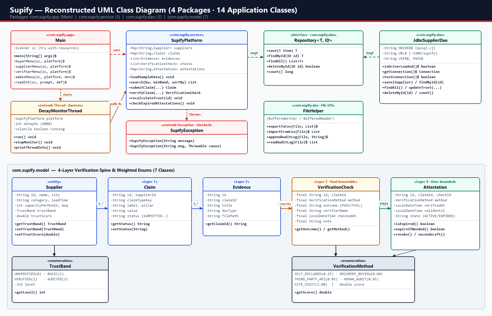
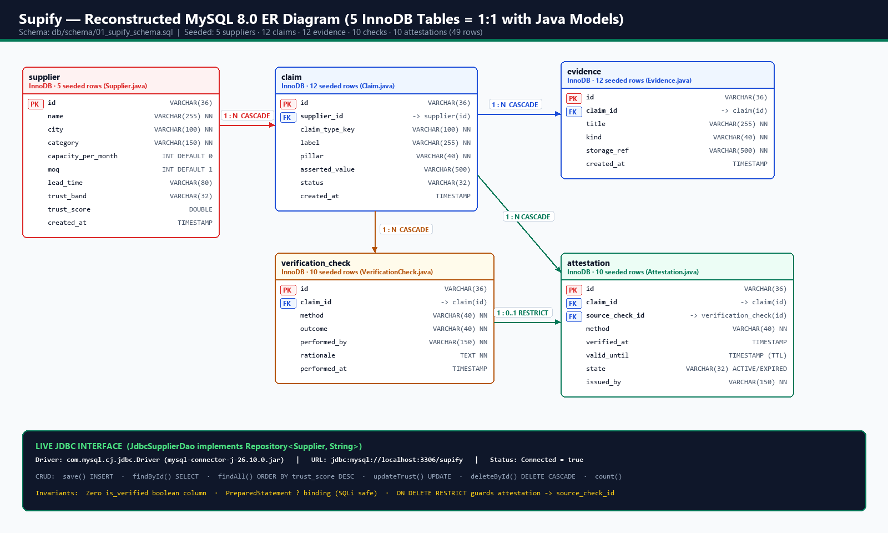
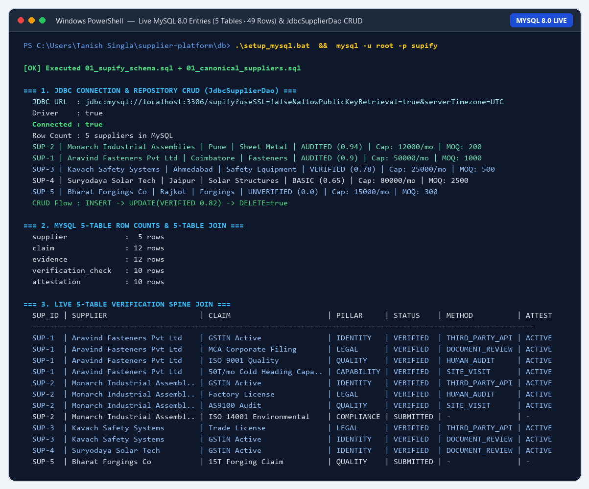

# Supify — Visual Albums (Diagrams, Database, CLI Demo & Frontend UI)

Organized gallery of all architecture diagrams, live MySQL 8.0 / JDBC outputs, pure-Java CLI demo captures, and frontend UI screenshots.

---

## 1. Architecture Diagrams (`albums/diagrams/`)

### Reconstructed UML Class Diagram (4 Packages · 14 Application Classes)

### Reconstructed MySQL 8.0 ER Diagram (5 InnoDB Tables = 1:1 with Java Models)

---

## 2. Live MySQL 8.0 & JDBC Outputs (`albums/database/`)

### Live 5-Table Entries (49 Seeded Rows) & `JdbcSupplierDao` CRUD

- [Verifier Queue SQL Output](database/02_uc01_verifier_queue_output.png)
- [Supplier Ledger SQL Output](database/03_uc02_supplier_ledger_output.png)
- [Faceted Search SQL Output](database/04_uc03_search_faceted_output.png)

---

## 3. Pure-Java Interactive CLI Demo (`albums/cli-demo/`)

1. **Buyer Discovery (`[1]`):** [01_buyer_search_compare.png](cli-demo/01_buyer_search_compare.png) — 5 seeded suppliers, Java Stream search (`Pune`), and side-by-side comparison.
2. **4-Layer Verification Spine (`[1] → [3]`):** [02_four_layer_spine.png](cli-demo/02_four_layer_spine.png) — `Claim → Evidence → VerificationCheck → Attestation` with live `29s` TTL countdown.
3. **Authority Split (`[2]` Supplier → `[3]` Verifier):** [03_supplier_to_verifier.png](cli-demo/03_supplier_to_verifier.png) — Supplier submits `ISO 14001` + PDF (`SUBMITTED`); Verifier approves via `HUMAN_AUDIT` and standing recalculates live (`0.85 → 0.87`).
4. **Admin Console & Live JDBC (`[4]`):** [04_admin_threads_io_jdbc_connected.png](cli-demo/04_admin_threads_io_jdbc_connected.png) — `DecayMonitor` daemon thread, `data/suppliers.csv` sync, append-only `data/audit.log`, and MySQL **`Connected: true`**.

---

## 4. Frontend UI Screenshots (`albums/frontend-ui/`)

- [01_landing_hero.png](frontend-ui/01_landing_hero.png) · [02_discovery_search.png](frontend-ui/02_discovery_search.png) · [03_comparison_matrix.png](frontend-ui/03_comparison_matrix.png) · [04_supplier_workspace_dashboard.png](frontend-ui/04_supplier_workspace_dashboard.png)
- [05_onboarding_form_step.png](frontend-ui/05_onboarding_form_step.png) · [06_portfolio_about.png](frontend-ui/06_portfolio_about.png) · [07_verification_engine_run.png](frontend-ui/07_verification_engine_run.png) · [08_protected_route_verifier_guard.png](frontend-ui/08_protected_route_verifier_guard.png)
- [09_supplier_profile_claims.png](frontend-ui/09_supplier_profile_claims.png) · [10_verifier_evidence_queue.png](frontend-ui/10_verifier_evidence_queue.png) · [11_error_boundary_fallback.png](frontend-ui/11_error_boundary_fallback.png)
