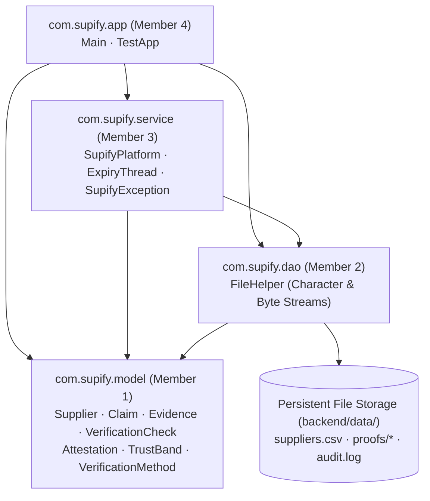
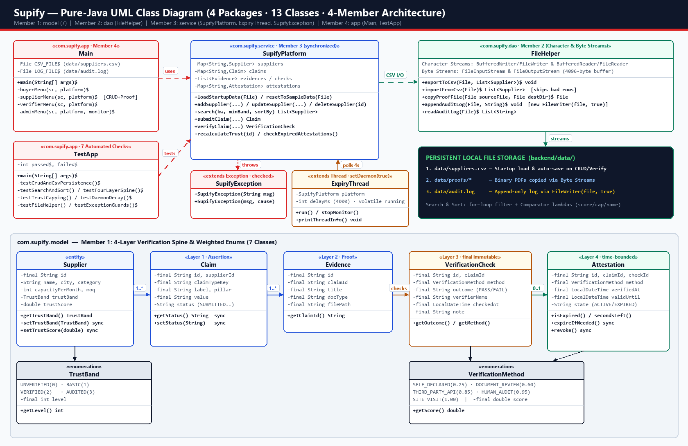
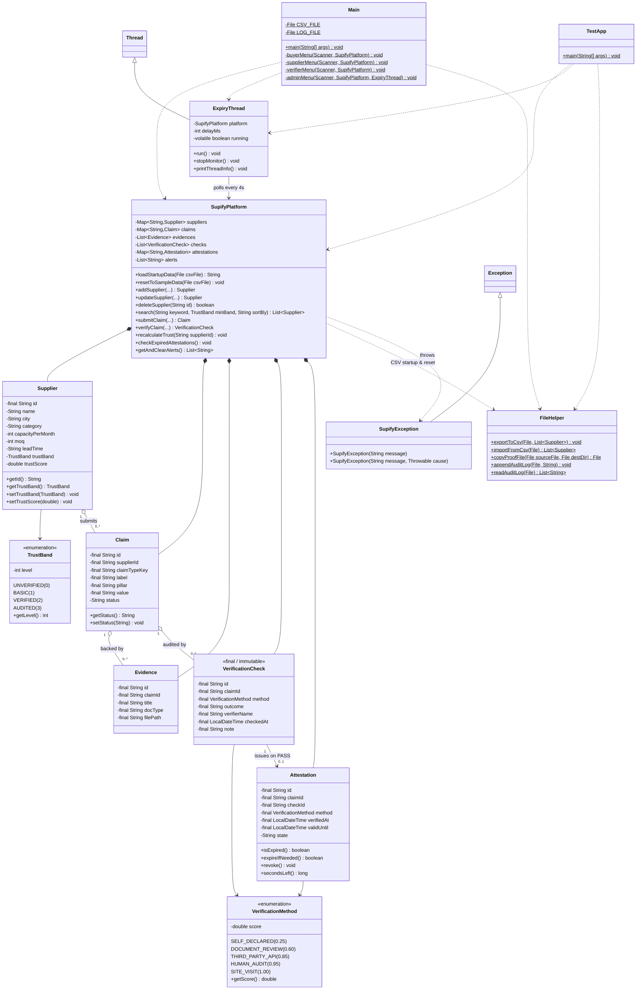
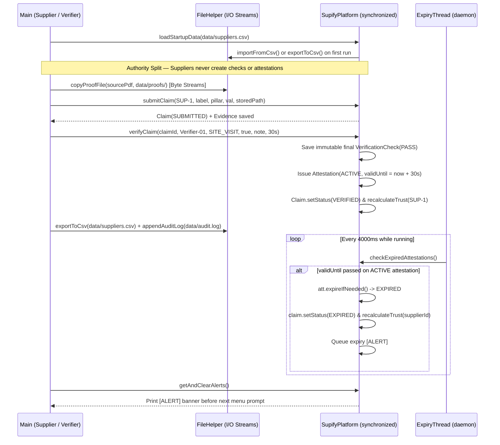

# Supify — Java Backend Architecture

Architecture specification for the **13-file pure-Java backend** under `backend/src/com/supify/` (**4 packages**: `model`, `dao`, `service`, `app`) — organized cleanly for a **4-member team**.

---

## 1. 4-Package Layered Architecture (1 Package per Team Member)

| Package | Owner | Classes (13 Total) | Responsibility |
| :--- | :---: | :--- | :--- |
| `com.supify.model` | Member 1 | `TrustBand`, `VerificationMethod`, `Supplier`, `Claim`, `Evidence`, `VerificationCheck`, `Attestation` | 4-layer verification spine domain entities & weighted enums |
| `com.supify.dao` | Member 2 | `FileHelper` | Buffered CSV persistence (`suppliers.csv`), binary proof copy (`data/proofs/`), & append-only `audit.log` |
| `com.supify.service` | Member 3 | `SupifyException`, `SupifyPlatform`, `ExpiryThread` | Checked validation exception, shared `synchronized` platform (Supplier CRUD, CSV startup/reset, lambda `Comparator` search, trust rules), background daemon |
| `com.supify.app` | Member 4 | `Main`, `TestApp` | Interactive 4-role CLI menus (`Buyer`, `Supplier`, `Verifier`, `Files & Monitor`) and 7-check automated suite |

---

## 2. Complete UML Class Diagram (13 Classes)

---

## 3. End-to-End Lifecycle Sequence (CRUD, Proof Copy, Attestation & Auto-Decay)

---

## 4. Concurrency, File I/O Streams & Trust Capping Rules

### Concurrency & Synchronization
- **Shared Monitor (`SupifyPlatform`):** All mutators and snapshots (`save`, `findAll`, `addSupplier`, `updateSupplier`, `deleteSupplier`, `loadStartupData`, `resetToSampleData`, `submitClaim`, `verifyClaim`, `recalculateTrust`, `checkExpiredAttestations`, `getAndClearAlerts`) are `synchronized` on the shared `SupifyPlatform` object so `main` and `ExpiryThread` never collide.
- **Daemon Lifecycle (`ExpiryThread`):** Calls `super("ExpiryThread")` and `setDaemon(true)` so background polling never blocks JVM exit. Uses `volatile boolean running = true` for cross-thread visibility, and `stopMonitor()` calls `interrupt()` to wake `Thread.sleep(4000)` immediately.

### Dual Stream File I/O (`FileHelper`)

| Storage Target | Stream Type & Classes | Behavior |
| :--- | :--- | :--- |
| `data/suppliers.csv` | **Character Streams:** `BufferedWriter(new FileWriter(file))` & `BufferedReader(new FileReader(file))` | Auto-loaded on startup (`loadStartupData`) and auto-saved on Add/Update/Delete/Verify/Exit; skips malformed CSV rows safely via `catch (IllegalArgumentException)` |
| `data/proofs/*` | **Byte Streams:** `FileInputStream` & `FileOutputStream` (`byte[4096]` buffer) | Copies real binary proof files (PDFs/images) attached in Supplier Menu `[5]` without corrupting binary bytes |
| `data/audit.log` | **Character Stream (Append Mode):** `BufferedWriter(new FileWriter(file, true))` | Appends timestamped audit lines (`[LocalDateTime] ...`) without erasing prior log entries |

### Trust Calculation & Pillar Capping (`SupifyPlatform.recalculateTrust`)
Only **`ACTIVE`** attestations count toward `avgScore = min(1.0, sum(method.getScore()) / max(3, activeCount))`:

| Active Pillar / Audit Condition | Resulting `TrustBand` | Score Rule |
| :--- | :--- | :--- |
| Missing active `IDENTITY` attestation | `UNVERIFIED` (Lv 0) | Capped at `<= 0.30` |
| Active `IDENTITY`, missing active `LEGAL` | `BASIC` (Lv 1) | Capped at `<= 0.65` |
| Active `IDENTITY` + `LEGAL`, plus `HUMAN_AUDIT`/`SITE_VISIT` and `avgScore >= 0.85` | `AUDITED` (Lv 3) | Full `avgScore` |
| Active `IDENTITY` + `LEGAL` (otherwise) | `VERIFIED` (Lv 2) | Full `avgScore` |
