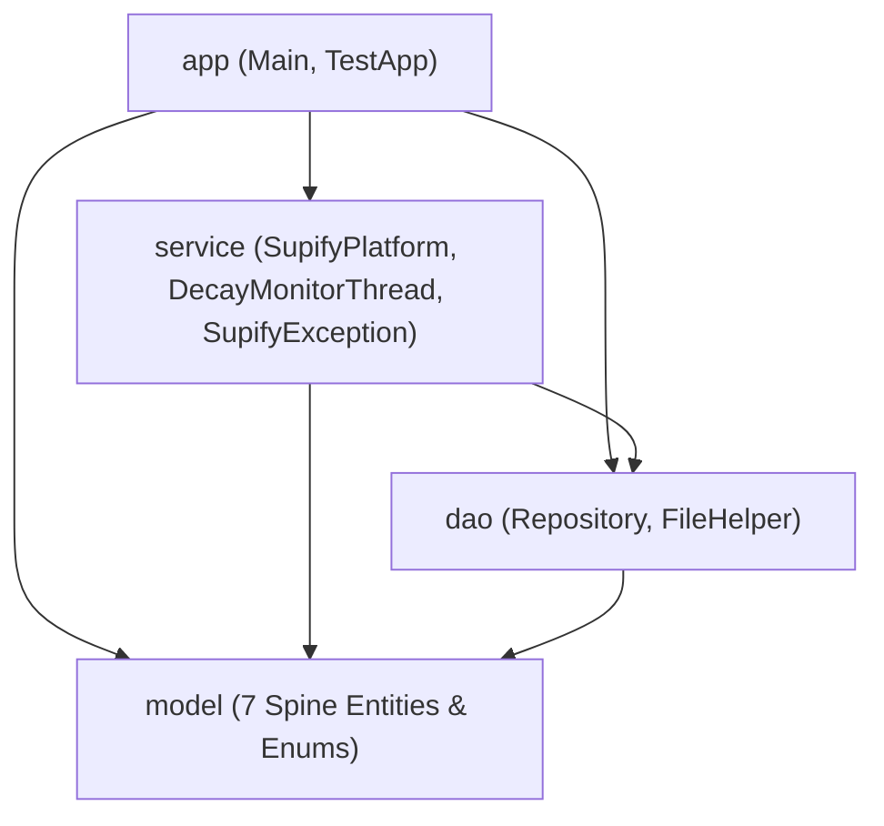
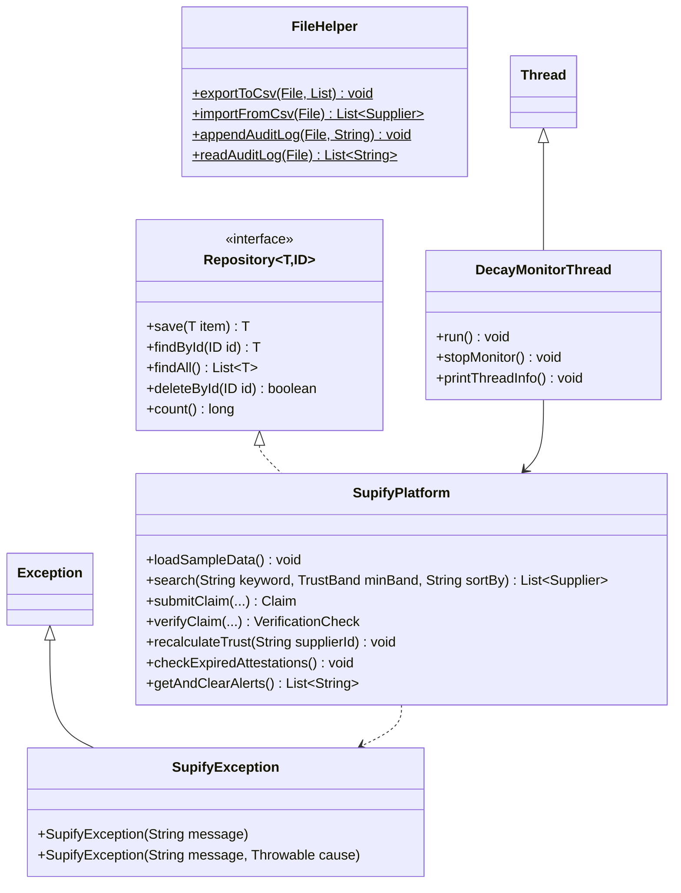

# Supify — Java Backend Architecture

Architecture summary for the 14-file pure-Java backend under `backend/src/com/supify/` (**4 packages**: `model`, `dao`, `service`, `app`).

---

## 1. 4-Package Architecture

| Package | Files | Role |
| :--- | :--- | :--- |
| `com.supify.model` | `TrustBand`, `VerificationMethod`, `Supplier`, `Claim`, `Evidence`, `VerificationCheck`, `Attestation` | 4-layer verification spine & enums |
| `com.supify.dao` | `Repository<T, ID>`, `FileHelper` | Generic CRUD contract, CSV/log File I/O |
| `com.supify.service` | `SupifyException`, `SupifyPlatform`, `DecayMonitorThread` | Custom checked exception, shared synchronized platform (storage, Stream search, trust rules), daemon thread |
| `com.supify.app` | `Main`, `TestApp` | Interactive console menus and 7 automated checks |

---

## 2. Core Class Relationships

---

## 3. Trust Calculation & Authority Split (`SupifyPlatform`)

1. **Supplier write path (`submitClaim`):** Creates `Claim` (`"SUBMITTED"`) and optional `Evidence`. Never creates checks or attestations.
2. **Verifier write path (`verifyClaim`):** Creates immutable `final VerificationCheck` (`"PASS"`/`"FAIL"`), issues time-bounded `Attestation` only on `"PASS"`, updates `Claim.status`, and calls `recalculateTrust(...)` all inside `synchronized` locks.
3. **TrustBand rules:** Only `ACTIVE` attestations count. Missing `IDENTITY` caps at `UNVERIFIED` (`<= 0.30`); missing `LEGAL` caps at `BASIC` (`<= 0.65`); `HUMAN_AUDIT`/`SITE_VISIT` + avg `>= 0.85` earns `AUDITED`; otherwise `VERIFIED`.
