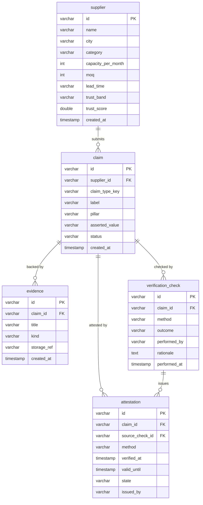
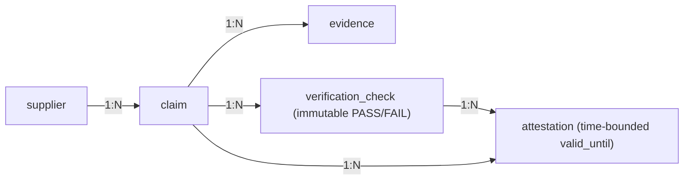

# Supify — MySQL 8.0 ER Diagram & Schema Architecture

Relational database specification for [`db/`](../db/README.md) and [`backend/`](../backend/README.md).

---

## 1. Entity–Relationship Diagram (5 Basic Tables = 1:1 with Java Models)

Matches [`db/schema/01_supify_schema.sql`](../db/schema/01_supify_schema.sql). Each table corresponds directly to one class in `backend/src/com/supify/model/` (`Supplier`, `Claim`, `Evidence`, `VerificationCheck`, `Attestation`).

---

## 2. Schema Notes & Verification Integrity

- **1:1 alignment with `com.supify.model`:** The 5 tables (`supplier`, `claim`, `evidence`, `verification_check`, `attestation`) mirror the 5 Java entity classes in `backend/src/com/supify/model/` directly.
- **No boolean verification shortcut:** No `is_verified` column exists; supplier trust is stored cleanly as `trust_band` + `trust_score` derived from active rows in `attestation`.
- **CLI runtime vs. SQL scripts:** The Java CLI runs in memory via `SupifyPlatform` and persists CSV exports and `audit.log` in `backend/data/` via `FileHelper`; `db/` holds the standalone MySQL 8.0 DDL schema and canonical seed data for relational querying (`mysql -u root -p supify`).
