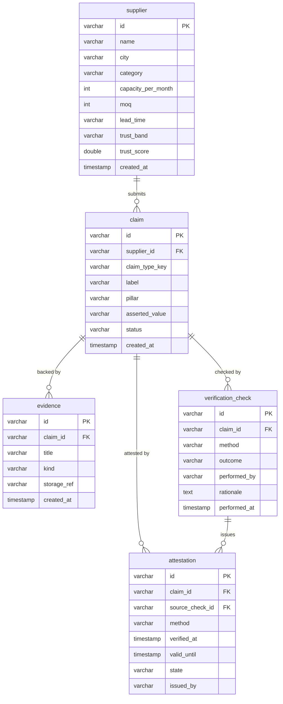
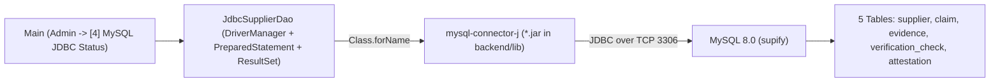

# Supify — MySQL 8.0 ER Diagram & JDBC Data Flow

Relational database specification for [`db/`](../db/README.md) and [`backend/`](../backend/README.md).

---

## 1. Entity–Relationship Diagram (5 Basic Tables = 1:1 with Java Models)

Matches [`db/schema/01_supify_schema.sql`](../db/schema/01_supify_schema.sql). Each table corresponds directly to one class in `backend/src/com/supify/model/` (`Supplier`, `Claim`, `Evidence`, `VerificationCheck`, `Attestation`).

---

## 2. Java JDBC Connection Flow

- **`JdbcSupplierDao`** (`backend/src/com/supify/dao/JdbcSupplierDao.java`) handles driver loading (`Class.forName`), `DriverManager.getConnection(...)`, `testConnection()`, and parameterized `PreparedStatement` + `ResultSet` CRUD against the `supplier` table (`save`, `findById`, `findAll`, `updateTrust`, `deleteById`, `count`).
- No boolean `is_verified` column exists; supplier trust is stored cleanly as `trust_band` + `trust_score` derived from the verification spine (`claim`, `evidence`, `verification_check`, `attestation`).
