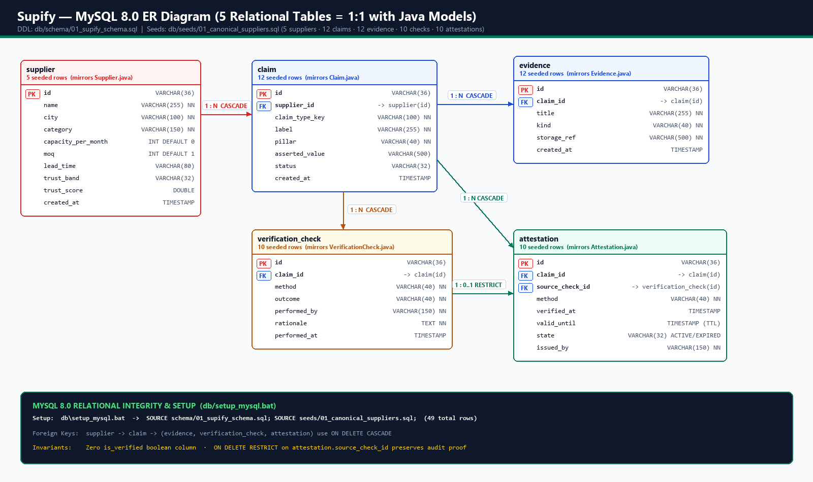
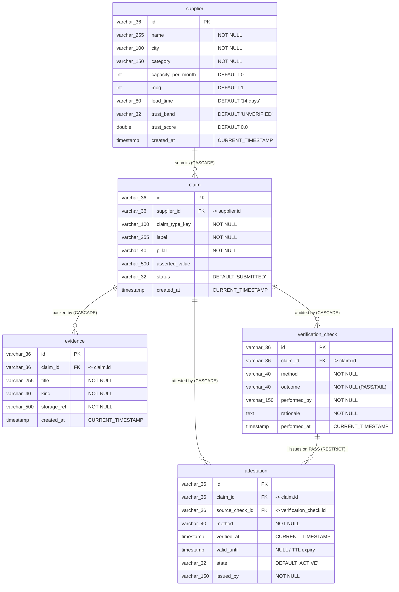
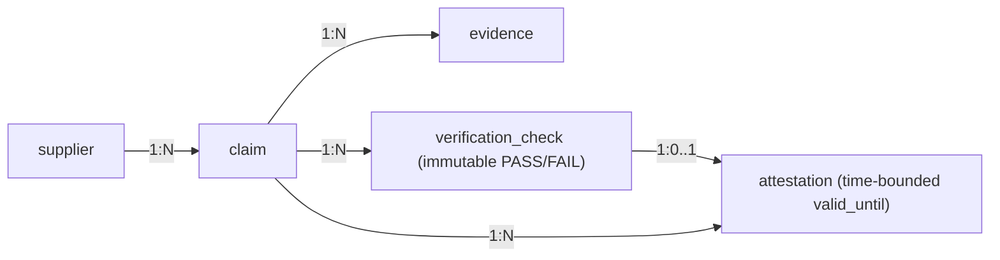
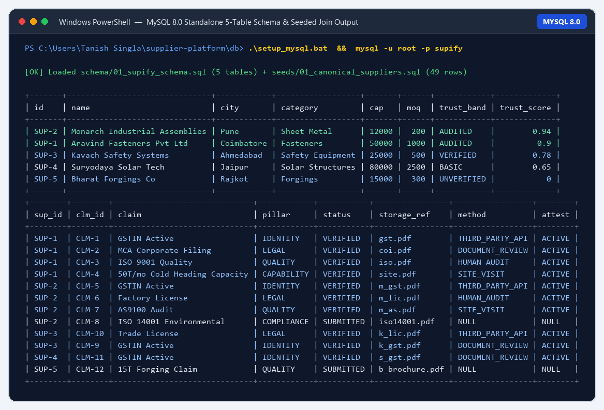

# Supify — MySQL 8.0 ER Diagram & Schema Architecture

Relational database specification for [`db/`](../db/README.md) and [`backend/`](../backend/README.md).

---

## 1. Entity–Relationship Diagram (5 Basic Tables = 1:1 with Java Models)

Matches [`db/schema/01_supify_schema.sql`](../db/schema/01_supify_schema.sql). Each table corresponds 1:1 to a domain entity class in `backend/src/com/supify/model/` (`Supplier`, `Claim`, `Evidence`, `VerificationCheck`, `Attestation`).

---

## 2. Schema Notes & Verification Integrity

- **1:1 alignment with `com.supify.model`:** The 5 tables (`supplier`, `claim`, `evidence`, `verification_check`, `attestation`) mirror the 5 Java entity classes in `backend/src/com/supify/model/` directly.
- **No boolean verification shortcut:** No `is_verified` column exists; supplier trust is stored cleanly as `trust_band` + `trust_score` derived from active rows in `attestation`.
- **Referential integrity (`FOREIGN KEY`):** `claim`, `evidence`, `verification_check`, and `attestation` cascade cleanly when a parent `supplier` or `claim` is deleted (`ON DELETE CASCADE`), while `attestation.source_check_id` uses `ON DELETE RESTRICT` so an issued attestation cannot lose its underlying check record.
- **CLI runtime vs. SQL scripts:** The Java CLI runs in memory via `SupifyPlatform` and persists `data/suppliers.csv`, `data/proofs/`, and `data/audit.log` in `backend/data/` via `FileHelper`; `db/` holds the standalone MySQL 8.0 DDL schema and canonical seed data initialized via `db\setup_mysql.bat`.

---

## 3. Seeded Database Entries (`db/seeds/01_canonical_suppliers.sql`)

Total seeded dataset across all 5 tables: **49 rows** (`5` suppliers · `12` claims · `12` evidence records · `10` checks · `10` attestations).

### Table 1: `supplier` (5 Rows)

| `id` | `name` | `city` | `category` | `capacity_per_month` | `moq` | `lead_time` | `trust_band` | `trust_score` |
| :--- | :--- | :--- | :--- | ---: | ---: | :--- | :--- | ---: |
| `SUP-1` | Aravind Fasteners Pvt Ltd | Coimbatore | Fasteners | 50,000 | 1,000 | 14 days | `AUDITED` | 0.90 |
| `SUP-2` | Monarch Industrial Assemblies | Pune | Sheet Metal | 12,000 | 200 | 21 days | `AUDITED` | 0.94 |
| `SUP-3` | Kavach Safety Systems | Ahmedabad | Safety Equipment | 25,000 | 500 | 10 days | `VERIFIED` | 0.78 |
| `SUP-4` | Suryodaya Solar Tech | Jaipur | Solar Structures | 80,000 | 2,500 | 18 days | `BASIC` | 0.65 |
| `SUP-5` | Bharat Forgings Co | Rajkot | Forgings | 15,000 | 300 | 15 days | `UNVERIFIED` | 0.00 |

### 5-Table Verification Spine Join (`supplier ⋈ claim ⟕ evidence ⟕ verification_check ⟕ attestation`)

| `supplier.id` | `claim.id` | `claim.label` | `pillar` | `claim.status` | `evidence.storage_ref` | `verification_check.method` | `attestation.state` |
| :--- | :--- | :--- | :--- | :--- | :--- | :--- | :--- |
| `SUP-1` | `CLM-1` | GSTIN Active | `IDENTITY` | `VERIFIED` | `gst.pdf` | `THIRD_PARTY_API` | `ACTIVE` (180d) |
| `SUP-1` | `CLM-2` | MCA Corporate Filing | `LEGAL` | `VERIFIED` | `coi.pdf` | `DOCUMENT_REVIEW` | `ACTIVE` (180d) |
| `SUP-1` | `CLM-3` | ISO 9001 Quality | `QUALITY` | `VERIFIED` | `iso.pdf` | `HUMAN_AUDIT` | `ACTIVE` (180d) |
| `SUP-1` | `CLM-4` | 50T/mo Cold Heading Capacity | `CAPABILITY` | `VERIFIED` | `site.pdf` | `SITE_VISIT` | `ACTIVE` (35s demo TTL) |
| `SUP-2` | `CLM-5` | GSTIN Active | `IDENTITY` | `VERIFIED` | `m_gst.pdf` | `THIRD_PARTY_API` | `ACTIVE` (180d) |
| `SUP-2` | `CLM-6` | Factory License | `LEGAL` | `VERIFIED` | `m_lic.pdf` | `HUMAN_AUDIT` | `ACTIVE` (180d) |
| `SUP-2` | `CLM-7` | AS9100 Audit | `QUALITY` | `VERIFIED` | `m_as.pdf` | `SITE_VISIT` | `ACTIVE` (180d) |
| `SUP-2` | `CLM-8` | ISO 14001 Environmental | `COMPLIANCE` | `SUBMITTED` | `iso14001.pdf` | — *(pending)* | — |
| `SUP-3` | `CLM-9` | GSTIN Active | `IDENTITY` | `VERIFIED` | `k_gst.pdf` | `DOCUMENT_REVIEW` | `ACTIVE` (180d) |
| `SUP-3` | `CLM-10` | Trade License | `LEGAL` | `VERIFIED` | `k_lic.pdf` | `THIRD_PARTY_API` | `ACTIVE` (180d) |
| `SUP-4` | `CLM-11` | GSTIN Active | `IDENTITY` | `VERIFIED` | `s_gst.pdf` | `DOCUMENT_REVIEW` | `ACTIVE` (180d) |
| `SUP-5` | `CLM-12` | 15T Forging Claim | `QUALITY` | `SUBMITTED` | `b_brochure.pdf` | — *(pending)* | — |
